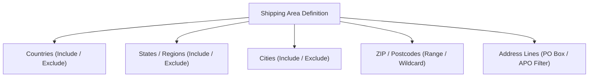

# Shipping Areas Management Guide

Shipping Areas are modular, reusable geographic definitions that can be linked to any number of shipping rules to control geographic rate adjustments.

---

## 1. Geographic Components

A single Shipping Area combines up to 5 geographic criteria:



---

## 2. Postcode Pattern Syntax

The postcode matching engine supports 3 flexible syntax styles:

### A. Exact Postcodes
```
90210
SW1A 1AA
10001
```

### B. Numeric Ranges
Use a hyphen between starting and ending numeric postal codes (inclusive):
```
99501-99695
01000-01999
90001-90089
```

### C. Wildcard Prefixes
Use an asterisk (`*`) to match all postal codes starting with specific characters:
```
995*     (matches 99501, 99510, 99599, etc.)
IV*      (matches all Inverness UK postcodes: IV1, IV28, IV63)
KW*      (matches Kirkwall UK postcodes: KW1 through KW14)
```

---

## 3. Address Lines Filtering (PO Box / Military)

To detect or exclude Post Office boxes or military fleet addresses:
- **Patterns:** Enter one keyword or pattern per line:
  ```
  PO Box
  P.O. Box
  Post Office Box
  Box
  APO
  FPO
  DPO
  ```
- **Modes:**
  - **Include (Contains):** The rule applies only if the customer's street address contains one of these terms.
  - **Exclude (Does not contain):** The rule is disqualified if the customer enters a PO Box or military address.

---

## 4. Reusability Across Rules

Once saved, a Shipping Area appears dynamically in the **Conditions** tab of all shipping rules:

```
If [Shipping Area] IS [US Non-Contiguous: Alaska & Hawaii]
```

This eliminates the need to duplicate complex state and postcode lists across multiple rules.
